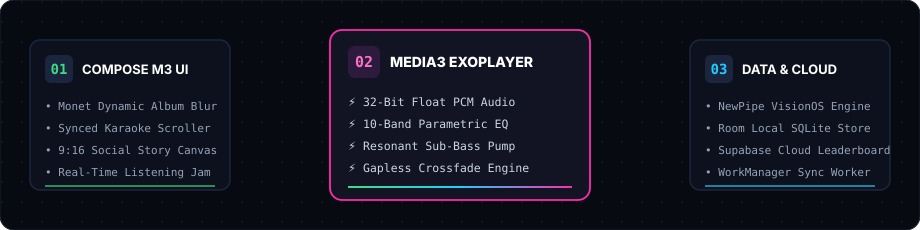
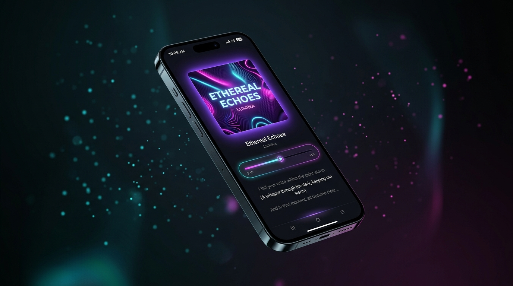
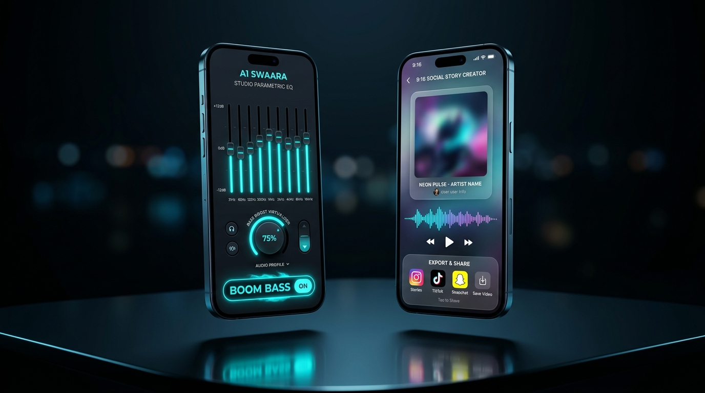

<p align="center">
  <a href="https://github.com/VarshuDev/A1Swaara">
    
  </a>
</p>

<p align="center">
  <strong>High-Performance Sovereign Audio Streaming Engine &amp; Studio Suite (Native Android Kotlin Source).</strong>
</p>

<p align="center">
  <a href="LICENSE"></a>
  <a href="https://kotlinlang.org"></a>
  <a href="https://developer.android.com/jetpack/compose"></a>
  <a href="https://developer.android.com/media/media3"></a>
  <a href="https://developer.android.com/training/data-storage/room"></a>
  <a href="https://github.com/VarshuDev"></a>
</p>

<p align="center">
  <a href="#-architecture--codebase-tour">🧬 Architecture</a> •
  <a href="#-visual-showcase">📱 Visual Showcase</a> •
  <a href="#-core-engines-in-code">⚡ Core Engines</a> •
  <a href="#-building-from-source">🛠️ Building</a> •
  <a href="#-tech-stack--libraries">📦 Tech Stack</a> •
  <a href="#-downloads--pre-built-apks">📦 Releases</a>
</p>

---

## ⚡ What is A1 Swaara?

**A1 Swaara** is a sovereign, high-fidelity music streaming application for Android engineered from the ground up on modern Android architecture: **Kotlin 2.x, Jetpack Compose Material 3, AndroidX Media3 ExoPlayer, Room SQLite, and Supabase**.

Designed for audiophiles and power users who care about source code sovereignty, A1 Swaara provides unthrottled **320 kbps audio streaming**, real-time synchronized karaoke lyrics, 10-band hardware parametric equalization, and zero interruptive ads or invasive tracking telemetry.

```
+──────────────────────────────────────────────────────────────────────────+
│  NATIVE ANDROID SUITE: A1 SWAARA SOURCE REPOSITORY                       │
│  AUTHOR: VarshuDev (https://github.com/VarshuDev)                        │
│  STACK: KOTLIN 2.X * JETPACK COMPOSE M3 * MEDIA3 EXOPLAYER * ROOM        │
+──────────────────────────────────────────────────────────────────────────+
```

---

## 🧬 Architecture & Codebase Tour

A1 Swaara follows a modular, reactive Clean Architecture pattern separating UI presentation, playback engines, and data stores:

<p align="center">
  
</p>

### Directory & Package Map

```
app/src/main/kotlin/com/varshudev/a1swaara/
├── cloud/              # Cloud synchronization & collaborative services
│   ├── SwaaraAccountSyncEngine.kt   # Two-way sync between Room DB and Supabase
│   ├── SwaaraJamEngine.kt           # Real-time group listening sessions (Jam)
│   ├── SwaaraRemoteConfig.kt        # Dynamic instance & bitrate failover
│   └── SwaaraTopListenerManager.kt  # Listener hours calculation & leaderboard
├── downloader/         # Background audio download manager & offline cache
├── extractor/          # Stream extractor negotiation & metadata parsers
├── models/             # Immutable data models (Song, Album, Artist, Playlist, Lyrics)
├── player/             # Media3 playback service & gapless crossfade engine
├── preferences/        # Datastore audio quality & theme settings
├── repositories/       # Room SQLite database entities & offline storage
├── service/            # Android foreground playback service & lockscreen controls
├── ui/                 # Declarative Jetpack Compose Material 3 presentation
│   ├── components/     # Reusable UI widgets (NowPlaying, EqualizerDeck, StorySheet)
│   └── screens/        # Full navigation screens (Home, Player, Jam, Podcasts, Profile)
├── updater/            # In-app OTA update manager (GitHub Releases API)
├── utils/              # Hardware canvas story exporter & synced lyrics parsers
└── work/               # Android WorkManager background sync workers
```

---

## 📱 Visual Showcase

<table align="center" width="100%">
  <tr>
    <td width="50%" align="center">
      <strong>🎵 Now Playing &amp; Synced Karaoke Lyrics</strong><br>
      <em>Dynamic ambient backlight glow with real-time timestamped word tracking.</em><br><br>
      
    </td>
    <td width="50%" align="center">
      <strong>🎛️ 10-Band Studio Equalizer &amp; Bass Pump</strong><br>
      <em>Hardware DSP shaping, +12dB sub-harmonic bass, and 9:16 Story Creator.</em><br><br>
      
    </td>
  </tr>
</table>

---

## ⚡ Core Engines in Code

### 1. 🎧 32-Bit Float PCM Audio & Media3 ExoPlayer
- Implemented in `com.varshudev.a1swaara.player`.
- Directly outputs **32-bit floating-point PCM audio** to Android hardware sinks and external USB DACs, preserving full dynamic range.
- **Unthrottled Stream Selection**: Prioritizes 251 kbps OPUS and 256 kbps AAC direct streams.
- **240s Anti-Stutter Lookahead Buffer**: Pre-caches audio to eliminate buffering interruptions on mobile cellular networks.

### 2. 🎤 Synchronized Karaoke Lyrics Engine
- Implemented in `com.varshudev.a1swaara.utils.SynchronizedLyrics`.
- Extracts and parses YouTube timestamped transcripts and standard LRC formats.
- Real-time auto-scroll animation synced to ExoPlayer playback timestamps with tactile line jumping.

### 3. 📸 9:16 Social Story Canvas Studio
- Implemented in `com.varshudev.a1swaara.utils.SwaaraStoryExporter`.
- Uses native Android hardware `Canvas` rendering to generate high-resolution 9:16 vertical cards (1080×1920) for Instagram and WhatsApp Stories.
- Renders dynamic audio waveforms, blurred album art backgrounds (`FastBlur.kt`), and customizable 60-character vibe quotes.

### 4. 👥 Real-Time Jam & Collaborative Listening
- Implemented in `com.varshudev.a1swaara.cloud.SwaaraJamEngine`.
- Enables real-time synchronized playback across friends via peer session tokens and Supabase WebSockets.

### 5. 🔄 1-Click Multi-Platform Playlist Importer
- Implemented in `com.varshudev.a1swaara.utils.PlaylistImporter`.
- Migrates existing playlists directly from **Spotify**, **YouTube Music**, or **CSV exports** without requiring authentication tokens.

### 6. 🎙️ Native Podcasts & Spoken Audio Hub
- Implemented in `com.varshudev.a1swaara.ui.screens.podcast`.
- Segregated spoken audio feed featuring top serial podcasts (Tech & AI, Mindset & Growth, Business, and True Crime) with dedicated episode bookmarking.

---

## 🛠️ Building From Source

### Prerequisites
- **JDK 17** or **JDK 21**
- **Android SDK** with `compileSdk = 37` and `minSdk = 24` (Android 7.0+)
- **Git**

### Build Commands

```bash
# 1. Clone the repository
git clone https://github.com/VarshuDev/A1Swaara.git
cd A1Swaara

# 2. Setup local properties (optional keys)
cp local.properties.example local.properties

# 3. Build debug APK
./gradlew assembleDebug

# 4. Install directly to a connected device via ADB
./gradlew installDebug
```

> **Build Output**: The compiled APK will be located at:  
> `app/build/outputs/apk/debug/app-debug.apk`

---

## 📦 Tech Stack & Libraries

| Category | Component / Library | Purpose |
| :--- | :--- | :--- |
| **Language** | Kotlin 2.x | Modern functional language & coroutines |
| **UI Framework** | Jetpack Compose M3 | Declarative reactive UI with Material You theming |
| **Audio Engine** | AndroidX Media3 ExoPlayer | Audio pipeline, foreground service, floating PCM |
| **Local Database** | Room SQLite + KSP | Offline music library, favorites, and listening history |
| **Networking** | OkHttp 4 / HTTP/3 QUIC | Resilient media streaming and API extraction |
| **Cloud Services** | Supabase Kotlin Client | Account backup, leaderboard stats, and realtime Jam |
| **Image Pipeline** | Coil 2.x | High-performance asynchronous album art loading |
| **Stream Extraction**| NewPipeExtractor | Open-source streaming protocol resolution |
| **Background Sync** | AndroidX WorkManager | Idempotent daily stats sync and background updates |

---

## 📦 Downloads & Pre-Built APKs

If you want ready-to-install standalone APK packages without compiling from source:

👉 **[Download Pre-Built A1 Swaara APKs from the Release Hub](https://github.com/VarshuDev/A1Swaara_apk/releases)**

---

## 👨‍💻 Author & Credits

Engineered, architected, and maintained with care by **[VarshuDev](https://github.com/VarshuDev)**.

Released under the **[GNU General Public License v3.0](LICENSE)**.
